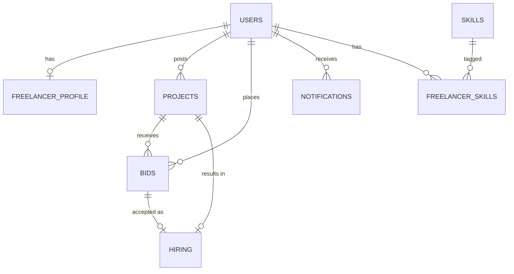

# FreelanceHub

A full-stack freelancer marketplace built for a DBMS course. Clients post projects, freelancers bid, the client hires one bid, and **both sides get live updates without refreshing the page**.

**Stack:** Python 3.10+, Flask, SQLite, Jinja2, vanilla JavaScript.

## Features
- Role-based accounts (Client / Freelancer) with hashed passwords and CSRF protection
- Clients post projects (budget, future deadline) and see bids sorted lowest first
- Freelancers browse open projects, bid once per project, and manage a skills-based profile
- **Live bid feed:** a client's project page polls every 3 s and shows new bids instantly
- **Live notifications:** bell counter and toast pop-ups for new bids, hire and rejection results, completion
- **Reject bids** with an optional reason the freelancer sees (and gets notified of); rejected bids can never be hired
- Atomic hiring transaction: only one freelancer can ever be hired per project
- Modern UI: animated landing page, dashboards with live stats, confirm dialogs, toasts, progress stepper, dark-mode support
- Contract lifecycle: `Open → Hired → Completed`
- Privacy: freelancers cannot see competitors' proposals

## ER diagram


## Database design
| Table | Purpose | Key constraints |
|---|---|---|
| `users` | accounts | PK, `UNIQUE(email)`, `CHECK(role)` |
| `freelancer_profile` | 1:1 extension of users | PK = FK, `CHECK(experience>=0, hourly_rate>=0)` |
| `skills`, `freelancer_skills` | **many-to-many** skills (normalised, 1NF) | composite PK, 2 FKs |
| `projects` | work posted by clients | `CHECK(budget>0)`, `CHECK(status IN ...)` |
| `bids` | proposals | `UNIQUE(project_id, freelancer_id)`, `CHECK(amount>0, delivery_days>0)` |
| `hiring` | contract record | `UNIQUE(project_id)` (one hire per project, enforced by the DB), `UNIQUE(bid_id)` |
| `notifications` | live notification feed | FK to users, indexed on `(user_id,is_read)` |

Other DBMS features: foreign keys enforced with `PRAGMA foreign_keys=ON`, indexes on all lookup columns, a **view** (`v_project_summary`: bid count and lowest bid via `LEFT JOIN … GROUP BY`), correlated subquery, multi-table JOINs, `ON DELETE CASCADE / RESTRICT` policy (child data cascades with a project; users with history cannot be deleted).

## Run locally
```bash
git clone <your-repo-url> && cd freelancehub
python -m venv venv && source venv/bin/activate      # Windows: venv\Scripts\activate
pip install -r requirements.txt
python app.py                                         # http://127.0.0.1:5000
python -m unittest discover -s tests -v               # run tests
```
The database is created and seeded automatically on first run. Set `SECRET_KEY` in the environment for any real deployment.

| Demo account | Email | Password |
|---|---|---|
| Client | client@demo.com | 1234 |
| Freelancer | freelancer@demo.com | 1234 |
| Freelancer 2 | asha@demo.com | 1234 |

**Try the live demo:** open two browsers. Log in as the client on `/project/1` in one, and as a freelancer in the other. Submit a bid and watch it appear on the client screen within 3 seconds.

## How "real-time" works
The browser polls two JSON endpoints every 3 seconds (`/api/notifications`, `/api/project/<id>/bids`) from `static/live.js` and updates the DOM only when something changed. Polling was chosen over WebSockets because it needs no extra dependency, works with Flask's dev server, and is simple to explain.

## Security measures
Password hashing (Werkzeug), CSRF tokens on every POST, state-changing actions are POST-only, ownership checks on hire/complete, input validation, server-side + DB-level constraints, parameterised SQL everywhere (no SQL injection), Jinja auto-escaping (no XSS).

## Known limitations / future work
- Polling adds load at scale; WebSockets (Flask-SocketIO) or SSE would replace it
- SQLite has limited write concurrency; use PostgreSQL/MySQL in production
- No payments, messaging, reviews or admin panel; no email verification or password reset
- No rate limiting on login

## Project structure
```
app.py  schema.sql  requirements.txt
templates/   static/(style.css, live.js)   tests/test_app.py
```
